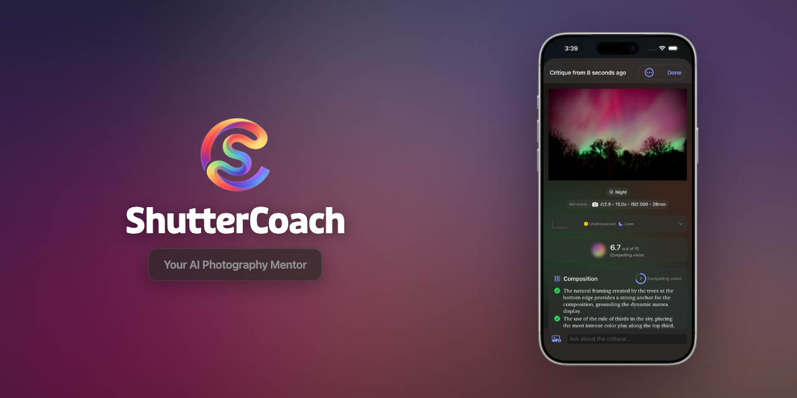
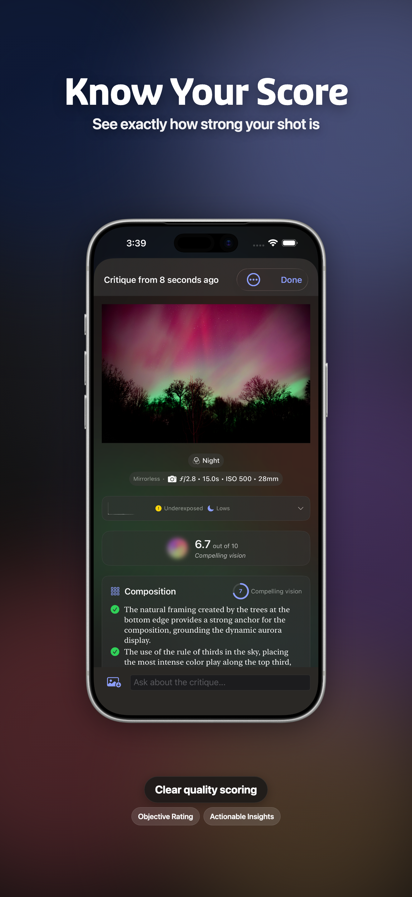
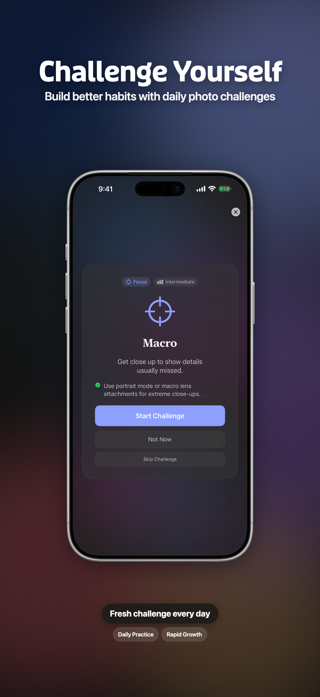
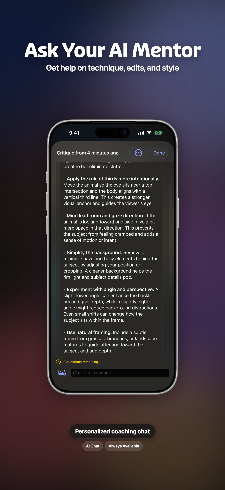

<!-- 1. Hero Banner (centered) -->

  

<!-- 2. App Icon + Title + Tagline -->

  

<h1 align="center">ShutterCoach</h1>

<strong>Your AI Photography Mentor</strong>

<!-- 3. Badges Row -->

  
  
  
  
  
  

---

<!-- 4. What is ShutterCoach -->
## What is ShutterCoach?

ShutterCoach gives you honest, encouraging feedback on your photos — like having a photography mentor in your pocket (and your browser). Available as a native **iOS app** and a **Chrome extension**, both powered by the same AI mentor, Luna.

---

<!-- 5. iOS App Features -->
## iOS App

- **AI-Powered Critique** — Detailed analysis across 6 skills: composition, lighting, exposure, focus, color, and storytelling
- **Photo DNA** — A personalized photography profile that evolves as your skills grow
- **Daily Challenges** — Fresh prompts every day with streak tracking to build better habits
- **Chat with Luna** — Ask follow-up questions and get deeper guidance from your AI mentor
- **Batch Import & Cull** — Import multiple photos, cull your library with AI assistance
- **Shoot Reports** — Session-level insights across a batch of photos
- **Critique Revision Engine** — Compare before/after shots to see how you've improved
- **Profile Tab** — Your photography hub with avatars, stats, and progress visualization
- **Achievements & Milestones** — 5 achievement categories to celebrate your progress
- **Aurora UI** — Streaming feedback with Aurora morphing animations and Liquid Glass design
- **Guided Onboarding** — 5-day guided journey with daily notifications and tips
- **Offline History** — Access your last 500 critiques without internet
- **Privacy-First** — Your photos are never stored on our servers

<!-- 6. Chrome Extension Features -->
## Chrome Extension

- **Right-Click Any Photo** — Get instant AI feedback on any image you find on the web
- **Two Coaching Modes** — **Study** (learn from any photo online) and **Coach** (upload your own work)
- **Follow-Up Chat** — Continue the conversation with Luna after every critique
- **Share Cards** — Canvas-rendered share cards to show off your scores
- **Critique History** — Browse past analyses stored locally
- **Aurora Glass UI** — Same premium glass card design and aurora background as the iOS app
- **Upgrade Gate** — 5-day trial, then one-time $9.99 purchase via Stripe

<!-- 7. How it Works (3-step) -->
## How It Works

| Step | | |
| :--: | :-- | :-- |
| **1** | **Share Your Shot** | Pick a photo from your library (iOS) or right-click any image on the web (Chrome) |
| **2** | **Get Honest Feedback** | AI analyzes composition, lighting, exposure, focus, color, and storytelling |
| **3** | **Level Up** | Chat with Luna, track your Photo DNA, and build a photography habit |

<!-- 8. Pricing Table -->
## Pricing

| | Free Trial (5 days) | Lifetime ($9.99) |
| :-- | :--: | :--: |
| **Duration** | 5 days, full access | Forever |
| **Feedback** | Unlimited | Unlimited |
| **Chat** | Unlimited | Unlimited |
| **AI Model** | Gemini 3.1 Flash Lite | Gemini 3.1 Flash Lite |

**No subscription. No recurring charges.** One-time $9.99 purchase unlocks everything forever.

- **iOS:** StoreKit 2 in-app purchase
- **Chrome Extension:** Stripe one-time payment

After the trial ends without purchase: iOS blocks critiques entirely; Chrome Extension allows 1 critique/day with reduced depth.

<!-- 9. Screenshots -->
## Screenshots

  
  &nbsp;&nbsp;
  
  &nbsp;&nbsp;
  

<!-- 10. Built With -->
## Built With

| Layer | Stack |
| :-- | :-- |
| **iOS** | Swift 6, SwiftUI, SwiftData |
| **Chrome Extension** | WXT, Svelte 5, Tailwind 4, Clerk, Stripe |
| **Backend** | Cloudflare Workers, Hono, TypeScript, D1, KV, R2, Queues |
| **Web** | Astro 6, Svelte 5, Tailwind 4 |
| **AI** | Gemini 3.1 Flash Lite via OpenRouter + Cloudflare AI Gateway |
| **Observability** | Datadog RUM, Analytics Engine |

<!-- 11. Community -->
## Community

We'd love to hear from you! ShutterCoach is closed-source, but your feedback shapes every update.

- **[Discussions](https://github.com/justinthevoid/ShutterCoach/discussions)** — Ask questions, share ideas, or just say hi
- **[Report a Bug](https://github.com/justinthevoid/ShutterCoach/issues/new?template=bug-report.yml)** — Help us squash issues (iOS or Chrome Extension)
- **[Request a Feature](https://github.com/justinthevoid/ShutterCoach/issues/new?template=feature-request.yml)** — Tell us what you want next
- **[Contributing Guidelines](CONTRIBUTING.md)** — How to participate

<!-- 12. Support -->
## Support

- **Website:** [shuttercoach.app](https://shuttercoach.app)
- **App Store:** [Download ShutterCoach](https://apps.apple.com/app/id6757127685)
- **Chrome Web Store:** Coming soon
- **Email:** support@shuttercoach.app
- **Twitter/X:** [@ShutterCoach](https://twitter.com/ShutterCoach)
- **Instagram:** [@ShutterCoach](https://instagram.com/ShutterCoach)
- **Privacy Policy:** [shuttercoach.app/privacy](https://shuttercoach.app/privacy)

Launched January 2026.

### Support Development

If ShutterCoach helps your photography, consider supporting its development:

- [Buy Me a Coffee](https://buymeacoffee.com/justinthevoid)
- [Ko-fi](https://ko-fi.com/joltik)
- [GitHub Sponsors](https://github.com/sponsors/justinthevoid)

<!-- 13. License -->
## License

All Rights Reserved. See [LICENSE](LICENSE).
